 

  

## 👋 About Sony

I'm **Thalari Sony Prashanthi** — also known as **Sony Prashanthi** — a **Senior Python Full Stack Developer** who turns complex business problems into clean, production-ready software.

Over **5+ years across banking, insurance, and retail**, I've shipped **FastAPI and Django microservices**, **React + TypeScript** frontends, **Kafka** event pipelines, and **AWS-native** deployments on EKS and ECS. I care about well-tested code, thoughtful APIs, and systems that stay calm under load.

Lately I've been weaving **AI/ML** into real products — **AWS Bedrock** for internal banking tooling, **RAG-style complaint assistants**, **fraud scoring with SHAP explainability**, and **healthcare risk models** — the sweet spot where full-stack craft meets intelligent systems.

I collaborate best in Agile teams, write pytest-backed Python, and love shipping features that analysts, operators, and end users actually enjoy using.

 

| | |
|---|---|
| 🎯 **Targeting** | AI/ML Engineer · Senior Python Full Stack Developer · Backend-leaning Full-Stack Engineer |
| 🏭 **Industries** | Banking · Insurance · Retail |
| 🎓 **Education** | M.S. Computer Science — Sacred Heart University (2023 – 2024) |
| 🧠 **Focus** | FinTech · InsurTech · LLM Integration · Microservices · Applied ML |
| 🟢 **Status** | Open to AI/ML and Full-Stack Python roles |

## 🧰 Skills in Focus

 

 

 

## 🚀 Projects That Show the Craft

*AI-forward builds with FastAPI, React, and production-minded ML.*

<table>
  <tr>
    <td align="center"></td>
    <td align="center"></td>
  </tr>
  <tr>
    <td align="center"></td>
    <td align="center"></td>
  </tr>
</table>

<b>📖 More detail on each project</b>

 

**🤖 AI Regulatory Document Assistant** — *FastAPI · React · LLMs · Auth*
Secure web app for uploading company policy documents and querying them in natural language. FastAPI backend, React frontend, authenticated REST APIs, and LLM integration for enterprise compliance workflows.

**🛡️ Insurance Claim Fraud Detector** — *scikit-learn · SHAP · FastAPI · React TS · Docker*
AI-powered fraud scoring with Low / Medium / High risk bands and SHAP explainability. Built for imbalanced data with recall and precision-recall AUC — not vanity accuracy.

**🏦 Bank Complaint Analyzer** — *NLP · pgvector · FastAPI · React TS · LLM*
Classifies bank complaints and drafts evidence-backed replies grounded in similar past cases. TF-IDF + Logistic Regression, PostgreSQL + pgvector retrieval, and LLM-drafted responses.

**🏥 Hospital Readmission Predictor** — *Gradient Boosting · SHAP · FastAPI · Streamlit · Docker*
Estimates 30-day readmission risk with Gradient Boosting and SHAP interpretability. Dashboard views by age and diagnosis; FastAPI + React/Streamlit + Docker deployment.

## 📈 Experience That Compounds

## 🎯 Focus Roles

## 📊 GitHub Stats

## 🤝 Let's Build Something Thoughtful

Targeting roles as an **AI/ML Engineer**, **Senior Python Full Stack Developer**, or backend-leaning full-stack engineer. Happy to chat about platforms, products, or a quick intro call.

- 🌐 **Portfolio:** [sonyprashanthi44.github.io/Portfolio](https://sonyprashanthi44.github.io/Portfolio/)
- 💼 **LinkedIn:** [Thalari Sony Prashanthi](https://www.linkedin.com/in/sony-prashanthi-thalari-4703651b9)
- 📧 **Email:** [sonyprashanthi44@gmail.com](mailto:sonyprashanthi44@gmail.com)
- 💬 **WhatsApp:** [+1 (551) 261-6797](https://wa.me/15512616797)
- 🐙 **GitHub:** [@sonyprashanthi44](https://github.com/sonyprashanthi44)

 

